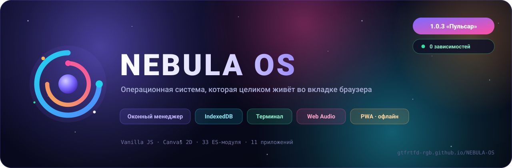

<p align="center">
  
</p>

<p align="center">
  <a href="https://github.com/gtfrtfd-rgb/NEBULA-OS/actions/workflows/deploy.yml"></a>
  
  
  
  <a href="https://github.com/gtfrtfd-rgb/NEBULA-OS/deployments"></a>
  
</p>

<p align="center">
  <a href="https://gtfrtfd-rgb.github.io/NEBULA-OS/"><b>🛸 Открыть NEBULA OS</b></a>
  &nbsp;·&nbsp;
  <a href="#приложения">Приложения</a>
  &nbsp;·&nbsp;
  <a href="#терминал">Терминал</a>
  &nbsp;·&nbsp;
  <a href="#публикация-на-github-pages">Деплой</a>
  &nbsp;·&nbsp;
  <a href="#диагностика">Диагностика</a>
</p>

---

## Что это

**NEBULA OS** — не лендинг про операционную систему, а сама операционная система: загрузочный экран, вход, рабочий стол с живыми обоями, панель задач, оконный менеджер с прилипанием к краям, файловая система на IndexedDB, оболочка командной строки, синтезатор музыки и сапёр. Всё это — один статический сайт без бэкенда, без сборщика и без единой npm-зависимости.

Открывается сразу populated: в файловой системе уже лежат документы, два сгенерированных изображения и системные файлы; терминал знает 25 команд; Волна FM синтезирует четыре станции в реальном времени.

| | |
|---|---|
| **Движок** | Vanilla JS, ES-модули, Canvas 2D, Web Audio |
| **Зависимости** | 0 — ни npm, ни CDN-библиотек |
| **Модулей** | 33 ES-модуля, 11 приложений, 6 CSS-слоёв |
| **Хранилище** | IndexedDB (`nebula-fs`), десятки гигабайт вместо 5 МБ |
| **Сеть** | только шрифты Google Fonts; всё остальное локально |
| **Офлайн** | service worker, установка на домашний экран, полный экран |
| **Деплой** | GitHub Actions → GitHub Pages по пушу в `main` |

---

## Быстрый старт

### Просто открыть

**https://gtfrtfd-rgb.github.io/NEBULA-OS/** — работает в браузере, ничего ставить не нужно.

### Локально

ES-модули требуют HTTP (при `file://` браузер их блокирует — страница сама покажет подсказку):

```bash
python3 -m http.server 8080
# или
npx serve .