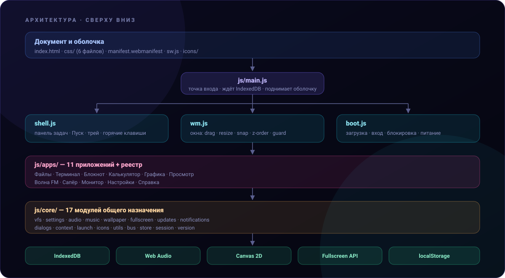

<p align="center">
  
</p>

<p align="center">
  <a href="https://github.com/gtfrtfd-rgb/NEBULA-OS/actions/workflows/deploy.yml"></a>
  
  
  
  <a href="https://github.com/gtfrtfd-rgb/NEBULA-OS/deployments"></a>
  
</p>

<p align="center">
  <a href="https://gtfrtfd-rgb.github.io/NEBULA-OS/"><b>🛸 Открыть NEBULA OS</b></a>
  &nbsp;·&nbsp;
  <a href="#приложения">Приложения</a>
  &nbsp;·&nbsp;
  <a href="#терминал">Терминал</a>
  &nbsp;·&nbsp;
  <a href="#публикация-на-github-pages">Деплой</a>
  &nbsp;·&nbsp;
  <a href="#диагностика">Диагностика</a>
</p>

---

## Что это

**NEBULA OS** — не лендинг про операционную систему, а сама операционная система: загрузочный экран, вход, рабочий стол с живыми обоями, панель задач, оконный менеджер с прилипанием к краям, файловая система на IndexedDB, оболочка командной строки, синтезатор музыки и сапёр. Всё это — один статический сайт без бэкенда, без сборщика и без единой npm-зависимости.

Открывается сразу наполненной: в файловой системе уже лежат документы, два сгенерированных изображения и системные файлы; терминал знает 25 команд; Волна FM синтезирует четыре станции в реальном времени.

| | |
|---|---|
| **Движок** | Vanilla JS, ES-модули, Canvas 2D, Web Audio |
| **Зависимости** | 0 — ни npm, ни CDN-библиотек |
| **Модулей** | 33 ES-модуля, 11 приложений, 6 CSS-слоёв |
| **Хранилище** | IndexedDB (`nebula-fs`), десятки гигабайт вместо 5 МБ |
| **Сеть** | только шрифты Google Fonts; всё остальное локально |
| **Офлайн** | service worker, установка на домашний экран, полный экран |
| **Деплой** | GitHub Actions → GitHub Pages по пушу в `main` |

---

## Быстрый старт

### Просто открыть

**https://gtfrtfd-rgb.github.io/NEBULA-OS/** — работает в браузере, ничего ставить не нужно.

### Локально

ES-модули требуют HTTP (при `file://` браузер их блокирует — страница сама покажет подсказку):

```bash
python3 -m http.server 8080
# или
npx serve .
```

Откройте <http://localhost:8080>. Service worker на `http://localhost` **не** регистрируется, поэтому локальная разработка никогда не видит устаревший кэш.

### Как телефоном

1. Откройте адрес в Chrome на Android.
2. Нажмите иконку **⤢** в панели задач — система займёт весь экран без адресной строки.
3. Меню браузера → **Установить приложение** / **На экран «Домой»**.
4. Запуск с иконки — настоящий полный экран и работа без сети.

На iPhone страница не получает Fullscreen API: включается компактный режим, а полный экран даёт именно запуск с домашнего экрана.

---

## Приложения

| Приложение | Что умеет | Клавиши |
|---|---|---|
| **Файлы** | папки, поиск, сортировка по имени/дате/типу, плитка и список, множественный выбор, переименование на месте, удаление с «Отменить», скачивание, недавние | <kbd>Ctrl</kbd>+<kbd>Alt</kbd>+<kbd>E</kbd> |
| **Терминал** | 25 команд над той же ФС, автодополнение по <kbd>Tab</kbd>, история, редирект `>` в файл, умные подсказки опечаток, `neofetch`, `df`, `tree` | <kbd>Ctrl</kbd>+<kbd>Alt</kbd>+<kbd>T</kbd> |
| **Блокнот** | черновик не создаёт файл, пока не сохранён; `Ctrl+S`, «Сохранить как…», Markdown-просмотр, счётчик слов, спрос перед закрытием несохранённого | <kbd>Ctrl</kbd>+<kbd>S</kbd> |
| **Калькулятор** | immediate-execution логика, %, ±, ⌫, лента истории с повторным использованием, ввод с клавиатуры | — |
| **Графика** | кисть со сглаживанием, распылитель, ластик, линия, прямоугольник, эллипс; размер 2–64, непрозрачность 10–100 %, 10 образцов + пипетка, 12 шагов отмены, сохранение в `/Изображения` и экспорт PNG | <kbd>Ctrl</kbd>+<kbd>Z</kbd> |
| **Просмотр** | зум колесом и слайдером, панорамирование, «Вписать», 1:1, «В Графику», скачивание | — |
| **Волна FM** | четыре генеративные станции (пады, арпеджио, эхо) на Web Audio, спектр-визуализатор, играет при закрытом окне — управление в трее | <kbd>Ctrl</kbd>+<kbd>Alt</kbd>+<kbd>M</kbd> |
| **Сапёр** | 9×9/10, 16×16/40, 20×14/55; первый клик всегда безопасен, аккорд по цифре, режим флажков для тача, рекорды по сложностям | — |
| **Монитор** | CPU и RAM по окнам, спарклайн нагрузки, **реальный FPS обоев**, аптайм, «Снять задачу» | — |
| **Настройки** | 6 акцентов, 2 темы, 4 живых обоев, анимации, звук, полный экран, качество рендера, карта хранилища, сброс | — |
| **Справка** | бортжурнал: клавиши, жесты, команды, хранилище, производительность | — |

---

## Управление

### Жесты окон

- Тяните заголовок — окно летит за курсором.
- Бросьте к **верхнему** краю — развернётся; к **левому/правому** — займёт половину экрана.
- Двойной клик по заголовку — развернуть/восстановить.
- Правый и нижний край — изменение размера.
- Клик по значку в панели сворачивает активное окно и возвращает свёрнутое.
- На телефоне окна сразу развёрнуты, перетаскивание отключено.

### Горячие клавиши

| Клавиши | Действие |
|---|---|
| <kbd>Ctrl</kbd>+<kbd>Alt</kbd>+<kbd>T</kbd> | Терминал |
| <kbd>Ctrl</kbd>+<kbd>Alt</kbd>+<kbd>E</kbd> | Файлы |
| <kbd>Ctrl</kbd>+<kbd>Alt</kbd>+<kbd>M</kbd> | Волна FM |
| <kbd>Ctrl</kbd>+<kbd>Alt</kbd>+<kbd>F</kbd> | Полный экран |
| <kbd>Ctrl</kbd>+<kbd>Alt</kbd>+<kbd>L</kbd> | Заблокировать |
| <kbd>Ctrl</kbd>+<kbd>Alt</kbd>+<kbd>←→↑↓</kbd> | Двигать окно (с <kbd>Shift</kbd> — размер) |
| <kbd>Ctrl</kbd>+<kbd>S</kbd> | Сохранить в Блокноте |
| <kbd>Ctrl</kbd>+<kbd>Z</kbd> | Отменить штрих в Графике |
| <kbd>F2</kbd> / <kbd>Delete</kbd> / <kbd>Enter</kbd> | Переименовать / удалить / открыть в Файлах |
| <kbd>Esc</kbd> | Закрыть меню, панель, диалог |

Правый клик работает по рабочему столу, иконкам, панели задач и файлам.

---

## Терминал

Оболочка работает над **той же** файловой системой, что видит Проводник: `echo привет > файл.txt` — и файл тут же появился в Файлах и записался в IndexedDB.

Опечатался — оболочка подскажет ближайшую команду по префиксу и расстоянию Дамерау — Левенштейна: `ca` → **cat**, `sl` → **ls**, `cta` → **cat**. Подсказку можно нажать, и она подставится в строку ввода.

```bash
neofetch                       # сводка о системе и палитра
df                             # реальная квота IndexedDB
tree ~/Документы               # дерево каталогов
echo новый текст > заметка.txt # создание/перезапись файла
open графика                   # запуск приложения
theme magenta                  # смена акцента на лету
wallpaper 3                    # смена обоев
music play                     # генеративный эфир
```

<details>
<summary><b>Полный список команд (25)</b></summary>

| Команда | Назначение |
|---|---|
| `help` | сгруппированная справка |
| `ls [путь]` | содержимое папки с размерами |
| `cd <путь>` | смена папки, `..` вверх, `~` корень |
| `pwd` | текущая папка |
| `cat <файл>` | прочитать файл |
| `touch <имя>` | создать файл или обновить время |
| `mkdir <имя>` | создать папку |
| `rm [-r] <имя>` | удалить, `-r` для папок; удаление можно отменить |
| `tree [путь]` | дерево с итогом «N папок, M файлов» |
| `echo текст > файл` | записать текст в файл |
| `df` | занято / свободно / квота / постоянное хранилище |
| `neofetch` | ОС, сборка, ядро, аптайм, обои, акцент, FPS |
| `open <приложение> [путь]` | запуск; алиасы русские и английские |
| `theme <цвет>` | `violet` `cyan` `magenta` `amber` `lime` `azure` |
| `wallpaper <1-4>` | Аврора · Туманность · Пульсар · Закат |
| `music play\|stop\|next` | управление Волной FM |
| `notify <текст>` | проверить центр уведомлений |
| `date` / `uptime` / `whoami` | время · аптайм · пользователь |
| `history` | история команд |
| `clear` | очистить экран (<kbd>Ctrl</kbd>+<kbd>L</kbd>) |
| `about` | версия и сборка |
| `reboot` | перезагрузить систему |
| `exit` | закрыть терминал |
| `sudo` | 🛸 инцидент будет доложен Звёздному совету |

<kbd>Tab</kbd> — автодополнение команд и имён файлов, <kbd>↑</kbd>/<kbd>↓</kbd> — история, <kbd>Ctrl</kbd>+<kbd>C</kbd> — сброс строки.

</details>

---

## Хранилище nebulaFS

Файлы живут в **IndexedDB**: база `nebula-fs`, объектное хранилище `nodes`, каждый узел дерева — отдельная запись. При изменении пишется только изменённый узел, а не всё дерево; поиск родителей делается одним проходом, при ошибке записи — экспоненциальная пауза вместо бесконечного ретрая.

Квота зависит от свободного места на диске — обычно десятки гигабайт. Посмотреть точно: `df` в терминале или **Настройки → Система**.

| Где | Что |
|---|---|
| IndexedDB `nebula-fs` | все файлы и папки |
| `nebula.settings.v1` | оформление, звук, полный экран, имя |
| `nebula.best.v1` | рекорды Сапёра |
| `nebula.vfs.v1` | legacy localStorage — мигрирует автоматически и удаляется |

**Постоянное хранилище.** Кнопка «Сделать постоянным» вызывает `navigator.storage.persist()` — браузер перестаёт вытеснять данные при нехватке места.

**Удаление обратимо.** Любое удаление (мышью или `rm`) даёт уведомление с кнопкой «Отменить», возвращающей объект на исходное место.

---

## Полный экран и установка

| Платформа | Поведение |
|---|---|
| Chrome / Edge, desktop | нативный Fullscreen API, <kbd>Ctrl</kbd>+<kbd>Alt</kbd>+<kbd>F</kbd> |
| Chrome Android | нативный полный экран + установка как PWA |
| Firefox | нативный полный экран |
| Safari iOS | Fullscreen API для страницы недоступен → компактный режим; полный экран через «На экран Домой» |
| Установленное приложение | `display: fullscreen` в манифесте, кнопка скрыта — уже во весь экран |

Вырезы и home-indicator учитываются: `env(safe-area-inset-*)` превращаются в числовые метрики, по которым оконный менеджер считает рабочую область. Поворот экрана и появление/скрытие панелей браузера пересчитывают раскладку.

---

## Производительность

| Приём | Эффект |
|---|---|
| Туманности растеризуются в ¼ разрешения и композитятся одним `drawImage` | в разы меньше заливки на кадр |
| Звёзды рисуются пакетным `fillRect` по 6 уровням яркости | вместо сотен path-операций |
| Обои не рисуются под экраном загрузки и выключения, вкладка в фоне засыпает | нулевая нагрузка, когда не видно |
| Режим «Экономное»: 30 FPS, DPR 0.75, меньше звёзд, без `backdrop-filter` | слабые устройства |
| Свёрнутые окна не считают графики Монитора и визуализатор Волны | процессор отдыхает |
| Проводник кэширует уменьшенные превью и сворачивает пачку событий ФС в один рендер | нет шторма перерисовок |
| Сапёр не читает layout на каждую клетку при каскадном открытии | нет layout thrashing |
| Оконный менеджер кэширует высоту рабочей области | нет `getComputedStyle` на кадр перетаскивания |
| IndexedDB: индекс узлов за один проход, инкрементальная запись | нет перезаписи всего дерева |

---

## Обновления и офлайн

Service worker включается **только на https** и устроен так, чтобы никогда не показать устаревшую сборку:

- HTML всегда ревалидируется (`cache: 'no-cache'`) — GitHub Pages держит `max-age=600`, и это обходится явно;
- имя кэша содержит SHA коммита: `nebula-app-1.0.3-<sha>` — новая публикация означает новый пустой кэш, старые удаляются;
- воркер регистрируется с `updateViaCache: 'none'`, поэтому сам `sw.js` всегда берётся из сети;
- если HTML на сервере новее самого воркера, воркер **снимает себя**, чистит кэши и перезапускает страницу — система самолечится;
- проверка обновлений идёт при фокусе, возврате на вкладку и раз в 10 минут; никакой кнопки «проверить обновления» нет — вместо неё полоса **«Новая сборка готова → Перезагрузить»** с указанием коммита.

Текущую сборку видно в трёх местах: меню Пуск внизу, экран загрузки и **Настройки → О системе**.

---

## Архитектура

<p align="center">
  
</p>

| Слой | Ответственность |
|---|---|
| `index.html`, `css/` | разметка оболочки, токены дизайна, слои стилей |
| `js/main.js` | порядок запуска: настройки → IndexedDB → обои → оболочка → загрузка |
| `shell.js` | панель задач, Пуск, трей, календарь, контекстные меню, клавиши |
| `wm.js` | окна: перетаскивание, resize, прилипание, z-order, guard закрытия |
| `boot.js` | BIOS-загрузка, вход, блокировка, перезагрузка, выключение |
| `js/apps/` | 11 приложений, каждое — модуль с `mount()` и жизненным циклом |
| `js/core/` | 17 модулей: ФС, настройки, звук, музыка, обои, полный экран, обновления, уведомления, диалоги, меню, иконки, утилиты, шина, хранилище, сессия, версия, запуск файлов |

Приложения общаются через шину событий (`vfs`, `wins`, `settings`, `fullscreen`, `notifications`) и синхронный API файловой системы — без конкурирующих источников состояния.

<details>
<summary><b>Полное дерево файлов</b></summary>

```
.github/workflows/deploy.yml   автопубликация на GitHub Pages
scripts/check-modules.mjs      проверка импортов/экспортов и ресурсов
docs/banner.svg                баннер README
docs/architecture.svg          схема архитектуры
index.html                     оболочка и экраны питания
404.html                       «сектор не найден»
manifest.webmanifest           PWA-манифест (display: fullscreen)
sw.js                          офлайн-кэш, версия по SHA коммита
icons/nebula.svg               иконка приложения
css/
  base.css                     токены, сброс, элементы управления
  windows.css                  оконный менеджер
  shell.css                    рабочий стол, панель, меню, экраны
  apps.css                     стили приложений
  terminal.css                 справка, neofetch, подсказки терминала
  updates.css                  полоса обновления, метка сборки
js/
  main.js  shell.js  boot.js  wm.js
  core/
    version.js utils.js bus.js store.js session.js icons.js
    settings.js audio.js music.js vfs.js wallpaper.js
    fullscreen.js updates.js notifications.js dialogs.js
    context.js launch.js
  apps/
    index.js explorer.js terminal.js editor.js calc.js paint.js
    music.js game.js monitor.js settings.js viewer.js help.js
```

</details>

---

## Публикация на GitHub Pages

Каждый пуш в `main` проверяет проект и публикует его. Собирать локально нечего.

### Разовая настройка

1. Запушьте проект в репозиторий GitHub.
2. **Settings → Pages → Build and deployment → Source: `GitHub Actions`.**
3. Пуш в `main` → вкладка **Actions** → job «Deploy NEBULA OS → GitHub Pages».
4. Адрес: `https://<пользователь>.github.io/<репозиторий>/` — он же в итоге job и в окружении `github-pages`.

Ручной запуск: **Actions → Deploy NEBULA OS → Run workflow**. Pull request проходит те же проверки, но не публикуется.

### Что проверяет пайплайн

| Шаг | Ловит |
|---|---|
| `scripts/check-modules.mjs` | `import` в несуществующий файл, отсутствующий именованный экспорт, битые ссылки HTML, невалидный манифест, пропавшие иконки |
| `node --check` по всем модулям | синтаксические ошибки |
| Проверка манифеста | неполный PWA-манифест |
| Версия и сборка едины | расхождение `version.js`, `sw.js`, `index.html`, `404.html`, баннера, бейджей и записи истории в README |
| Сборка `_site/` | только файлы сайта + `.nojekyll` |
| Штампы сборки | не подставленный `__BUILD_ID__`, отсутствие метки в HTML |

Все пути относительные, поэтому сайт одинаково работает в корне домена и в подпапке репозитория — `base` настраивать не нужно.

---

## Совместимость

| Браузер | Статус |
|---|---|
| Chrome / Edge 90+ | всё, включая батарею устройства и установку PWA |
| Firefox 90+ | всё; данные батареи симулируются (Battery API недоступен) |
| Safari macOS 15+ | всё; полный экран через префиксный API |
| Chrome Android | всё + нативный полный экран |
| Safari iOS 15+ | работает; полный экран — через «На экран Домой» |

Нужны: ES-модули, IndexedDB, Canvas 2D, Web Audio. Без IndexedDB система переходит в режим памяти и честно предупреждает, что файлы живут до перезагрузки.

---

## Приватность

Ни аналитики, ни телеметрии, ни аккаунтов, ни серверных запросов. Файлы, настройки и рекорды не покидают браузер. Единственный внешний ресурс — шрифты Google Fonts; они кэшируются воркером, а офлайном подставляются системные.

---

## Диагностика

| Симптом | Причина и решение |
|---|---|
| Белый или чёрный экран при открытии файла | Открыто через `file://`. Запустите `python3 -m http.server 8080` |
| Показывает старую сборку | Обновите страницу: воркер ревалидирует HTML и снимет себя при несовпадении сборки. Крайний случай — DevTools → Application → Storage → Clear site data |
| «Хранилище недоступно» | Приватный режим или запрет IndexedDB. Система работает в памяти до перезагрузки |
| «Ошибка записи nebulaFS» | Кончилось место на диске. Освободите его или удалите лишние файлы |
| Нет полного экрана на iPhone | Safari не отдаёт его странице. Добавьте на «Домой» и запускайте с иконки |
| Нет звука | Браузер включает аудио по жесту: нажмите «Войти в систему». Проверьте иконку звука в трее и в виджете |
| Тормозит на слабом устройстве | Настройки → Система → Качество рендера → **Экономное** |

Текущая сборка всегда видна внизу меню Пуск — по ней сразу понятно, обновился ли сайт.

---

## Ограничения

- Одна вкладка — одна сессия: одновременное редактирование в двух вкладках не синхронизируется, побеждает последняя запись.
- Изображения хранятся как dataURL, это примерно +33 % к их размеру.
- Импорта файлов из ОС и drag-and-drop снаружи пока нет; скачать файл наружу можно.
- Настройки и рекорды лежат в localStorage — они малы, но это отдельный от файлов слой.

---

## История версий

### 1.0.3 «Пульсар» · 2026.11.23
- Четыре мобильных визуальных дефекта устранены: аватар и кнопка входа больше не сплющиваются в горизонтали, «Пропустить» не наезжает на лог загрузки, кружки акцентов не налезают на подпись строки настроек, терминал не обрезает текст слева.
- Экраны загрузки и входа получили компактную раскладку для низких экранов; все их элементы защищены от сжатия.
- Строки настроек переносятся, а не сжимают подпись; приглашение терминала и поле ввода раскладываются на две строки на телефоне.
- Подсказки опечаток в терминале ранжируются по префиксу и расстоянию Дамерау — Левенштейна: `ca` → **cat**, а не `cd`; подсказку можно нажать, чтобы подставить в строку.
- CI сверяет версию и сборку ещё и с баннером, бейджами и записью истории версий.

### 1.0.2
- Убрана кнопка «Проверить обновления» — её заменяет настоящее автообновление.
- Полоса «Новая сборка готова» с указанием коммита и кнопкой перезагрузки.
- Метка сборки в меню Пуск, на экране загрузки и в «О системе».
- Воркер больше не отдаёт устаревшие файлы: ревалидация HTML, `updateViaCache: 'none'`, самолечение при несовпадении сборки.
- Новый README с баннером и схемой архитектуры.

### 1.0.1
- Файловая система переехала на IndexedDB с автомиграцией.
- Полный экран для телефонов, PWA-манифест, безопасные зоны.
- Автопубликация на GitHub Pages со статической проверкой модулей.
- Пакет оптимизаций рендера и записи; исправлены импорты, сетка иконок, жизненный цикл Блокнота.

### 1.0.0
- Первый выпуск: оболочка, оконный менеджер, 11 приложений, терминал, генеративная музыка, сапёр.

---

## Разработка

Версия и сборка живут в одном месте — `js/core/version.js`. `sw.js`, `index.html`, `404.html`, баннер и README сверяются с ними в CI, расхождение валит сборку. Порядок подъёма версии: поменять `VERSION` и `BUILD`, синхронизировать `sw.js`, заголовок и строку загрузки в `index.html`, подпись в `404.html`, пилюлю в `docs/banner.svg`, бейджи и запись истории в README.

```bash
node scripts/check-modules.mjs   # та же проверка, что в CI
python3 -m http.server 8080      # локальный запуск
```

Соглашения: ES-модули без зависимостей, синхронный API файловой системы поверх памяти с инкрементальной записью, обмен между частями через шину событий, у каждого приложения — `mount()` и честная уборка таймеров и слушателей в `onClose`.

> Форкнули репозиторий — замените `gtfrtfd-rgb/NEBULA-OS` в бейджах и ссылках на свой.